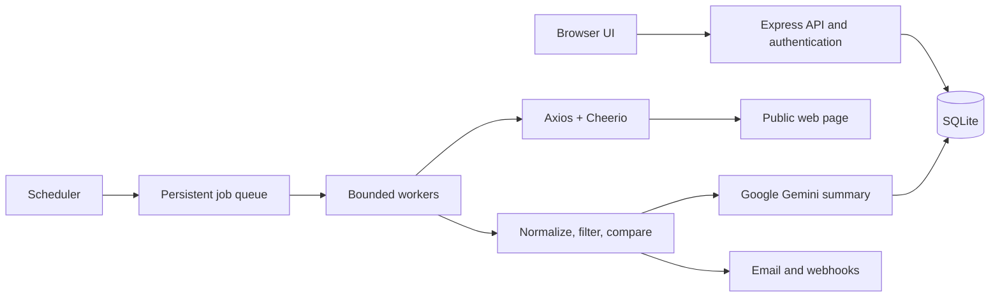

# Website Change Detector

Monitor public web pages and get notified when meaningful content changes. Website Change Detector combines scheduled checks, configurable noise filtering, version history, and alert delivery in a lightweight Node.js service.

## Project overview & live links

The production service is deployed on Railway:

- **Live application:** [website-change-detector-production.up.railway.app](https://website-change-detector-production.up.railway.app/)
- **Live scraper check:** [Open /test-status](https://website-change-detector-production.up.railway.app/test-status) — runs the same HTTP/Cheerio smoke check used by `npm test` and returns a JSON result with status and extracted text.
- **HLD & LLD documentation:** [Open /docs](https://website-change-detector-production.up.railway.app/docs) — in-app system architecture, data model, module responsibilities, and reliability notes.

The service accepts public page URLs, checks them on a schedule, compares normalized text against saved versions, and alerts users when a change passes their sensitivity and noise-filter settings.

## Key features

- **Google SSO:** Passport.js and Google OAuth 2.0, with verified-email account linking and an OAuth state check. Configure Google credentials to enable the option.
- **Password authentication:** Email sign-up and sign-in with an 8-character minimum plus uppercase, lowercase, numeric, and special-character requirements. Passwords are stored as bcrypt hashes; legacy scrypt hashes are upgraded on successful sign-in.
- **Persistent sessions:** Both sign-in methods use the app’s database-backed session cookie, so accounts return to the same watches after browser restarts.
- **Automated change detection:** A scheduler and persistent job queue check each distinct URL once per cycle, even when multiple users watch that page.
- **Noise controls:** Strip common dynamic noise, select CSS regions to watch or ignore, tune sensitivity, and filter alerts by keywords.
- **Useful history and alerts:** Review text changes and per-page timelines. Send email or Telegram/Discord webhook alerts, with deduplication and optional daily digests.
- **AI-Powered Change Summaries (powered by Google Gemini):** Set `GEMINI_API_KEY` to have the Google Gen AI SDK summarize each meaningful before/after change in one concise sentence. The summary is saved with the SQLite snapshot and appears in the version timeline; without a key or if Gemini is unavailable, the app uses its built-in summary.
- **Per-watch AI summaries:** Choose whether Gemini writes summaries in each watch’s add or edit settings. Turning the option off keeps the built-in change summary.
- **Summary prompt styles:** Choose General Summary, Price & Inventory Focused, or Short & Punchy for each watch; the preference is saved in SQLite and shapes Gemini’s instructions.
- **Exportable watch history:** Download an individual watch’s snapshots, text, summaries, line-change counts, and alert delivery log as CSV or JSON.
- **Visual diff statistics:** Each saved change records added and removed line counts, shown as compact pills beside the summary in the version timeline.
- **Tracked numbers:** Monitor prices, stock counts, ratings, or other numeric values with charts and threshold alerts.
- **Responsive, mobile-friendly dashboard:** The web dashboard is optimized for mobile screens and viewports of all sizes. Navigation, tables, content panels, and modal forms adapt to narrow screens without horizontal scrolling.
- **Dark and light themes:** A sun/moon navigation toggle switches between dark and light mode across the landing page, sign-in screens, dashboard, and architecture docs. The selected theme is saved in `localStorage` and restored on later visits; tables, forms, dialogs, and status badges are styled for both palettes.
- **Lightweight scraping:** Axios fetches initial page HTML and Cheerio extracts text. No Playwright, Chromium download, or system browser installation is required.

### Responsive dashboard

The dashboard uses responsive layouts and spacing across phone, tablet, and desktop viewports. Navigation and form controls reflow on narrow screens, and tables and dialogs remain usable without forcing horizontal page scrolling.

## Architecture: HLD & LLD summary

### High-level design



The Express service serves the frontend and JSON API. A scheduler finds due pages and places checks into a SQLite-backed queue. Bounded workers fetch one copy of each shared URL, then evaluate the result against each watch’s selectors, sensitivity, and alert preferences. For meaningful changes, the worker uses the watch’s selected Gemini prompt style to create a summary before saving the snapshot. Meaningful versions are saved and notifications are delivered through configured channels.

### Low-level design

| Module | Responsibility |
|---|---|
| `src/server.js` | Express routes, request validation, password and Google auth, application sessions, dashboard APIs, and status/docs routes. |
| `src/scraper.js` | Public-URL HTTP fetching, redirect handling, response classification, and Cheerio text extraction. |
| `src/queue.js` | Persistent job enqueueing, claiming, locking, retries, and completion. |
| `src/worker.js` | Scheduled checks, snapshot creation, significance decisions, and alert orchestration. |
| `src/extract.js`, `src/noise.js`, `src/diff.js` | Text normalization, noise removal, sensitivity evaluation, and version comparisons. |
| `src/alerts.js` | Notification delivery, retry state, deduplication, signed links, and digests. |
| `src/db.js` | SQLite schema and safe startup migrations. |
| `src/util/ssrf.js` | Public-address validation for watch URLs and redirect destinations. |

Core data is stored in SQLite tables for `users`, `sessions`, `pages`, `watches`, `snapshots`, `jobs`, `alerts`, `trackers`, and `readings`. A `pages` row is shared by all users watching the same normalized URL; individual `watches` retain per-user settings, including the AI summary toggle and prompt style. Snapshots store extracted text, summaries, and added/removed line counts. The authenticated watch export includes retained snapshots and alert delivery logs in CSV or JSON. Snapshot hashes prevent unchanged content from creating duplicate versions, and alert deduplication keys prevent repeated delivery.

### Reliability and security

- Fetches have timeouts, response-size limits, redirect limits, per-host request spacing, bounded concurrency, and capped retries.
- Private and loopback addresses are rejected, and each redirect is checked again.
- HTTP failures, blocks, and bot challenges are recorded as status outcomes; they are not treated as page changes.
- Password sign-up policy is enforced by the server. Passwords use bcrypt-compatible hashing via `bcryptjs`; existing scrypt accounts migrate after a successful login.
- Google OAuth requires a verified email. Its short-lived `SameSite` state cookie protects the callback; successful OAuth creates the same persistent app session as password login.

**Scraping limitation:** The scraper reads initial HTML and does not execute page JavaScript. Client-rendered content, screenshot diffs, and server-side visual picking are not available in HTTP-only mode.

## Tech stack

- **Runtime:** Node.js 22.13+ (built-in `node:sqlite`)
- **Web server:** Express 4
- **Scraping:** Axios, Cheerio
- **Authentication:** Passport.js, `passport-google-oauth20`, `bcryptjs`
- **Persistence:** SQLite
- **Change analysis:** `diff`, custom extraction and noise filtering
- **Notifications:** Nodemailer, Telegram/Discord webhooks
- **Frontend:** Responsive HTML, CSS, and browser JavaScript
- **Deployment:** Railway

## Local installation

### Requirements

- Node.js **22.13 or newer**
- npm

### Run the app

```bash
git clone <https://github.com/dhruvtrivedi-hub/website-change-detector.git>
cd website-change-detector
npm install
cp .env.example .env
npm start
```

Open [http://localhost:3000](http://localhost:3000). The first visit presents the landing page, then users can create an account with email and password or use Google after OAuth credentials are configured.

To enable AI-powered change summaries locally, copy `.env.example` to `.env` and replace the `GEMINI_API_KEY` placeholder with your Google Gemini API key. `GEMINI_API_KEY` is required for Gemini summaries; the rest of the app can run without it using built-in summaries. The server reads `.env` on startup. Keep `.env` private and use `.env.example` as the shareable template.

Run the scraper smoke check with:

```bash
npm test
```

By default, the test checks a stable public HTML page. Set `SCRAPER_TEST_URL` to run it against another public page. The same check is available from `/test-status` in the running service.

### Environment configuration

| Variable | Purpose |
|---|---|
| `PORT` | Port supplied by the hosting platform; defaults to `3000` locally. |
| `BASE_URL` | Public application origin used for secure cookies and generated links. |
| `DATA_DIR` | SQLite database and generated data directory; defaults to `./data`. |
| `SECRET` | Stable secret for signed links and encrypted integration credentials. Set this in production. |
| `GOOGLE_CLIENT_ID` | Google OAuth client ID. |
| `GOOGLE_CLIENT_SECRET` | Google OAuth client secret. |
| `GOOGLE_CALLBACK_URL` | Exact OAuth redirect URI; defaults to `${BASE_URL}/auth/google/callback`. |
| `SCRAPER_TEST_URL` | Optional public URL used by `npm test` and `/test-status`. |
| `SCRAPER_USER_AGENT` | Optional identifying User-Agent for monitored page requests. |
| `SMTP_URL`, `MAIL_FROM` | Optional email delivery configuration. Without SMTP, messages are logged. |
| `GEMINI_API_KEY` | Optional Gemini API key for AI-written version and alert summaries. Without it, the built-in summary is used. |
| `GEMINI_MODEL` | Optional Gemini model ID; defaults to the low-latency `gemini-3.5-flash-lite`. |
| `CONCURRENCY` | Maximum number of page checks processed in parallel; defaults to `3`. |

### Enable Google sign-in

1. Create a Web OAuth client in Google Cloud Console.
2. Add `https://website-change-detector-production.up.railway.app/auth/google/callback` to its authorized redirect URIs.
3. Set `GOOGLE_CLIENT_ID`, `GOOGLE_CLIENT_SECRET`, `GOOGLE_CALLBACK_URL`, `BASE_URL`, and a stable `SECRET` in the Railway service environment.
4. Restart or redeploy the service. The Google option appears on the landing and sign-in pages when both client credentials are present.

### Railway deployment notes 

Use `npm install` as the build command and `npm start` as the start command. Railway provides `PORT` at runtime. Attach a persistent volume and set `DATA_DIR` to its mount path (for example, `/data`) to retain the SQLite database across deployments. Keep `SECRET` stable between releases so existing signed links and encrypted integration credentials remain valid.
